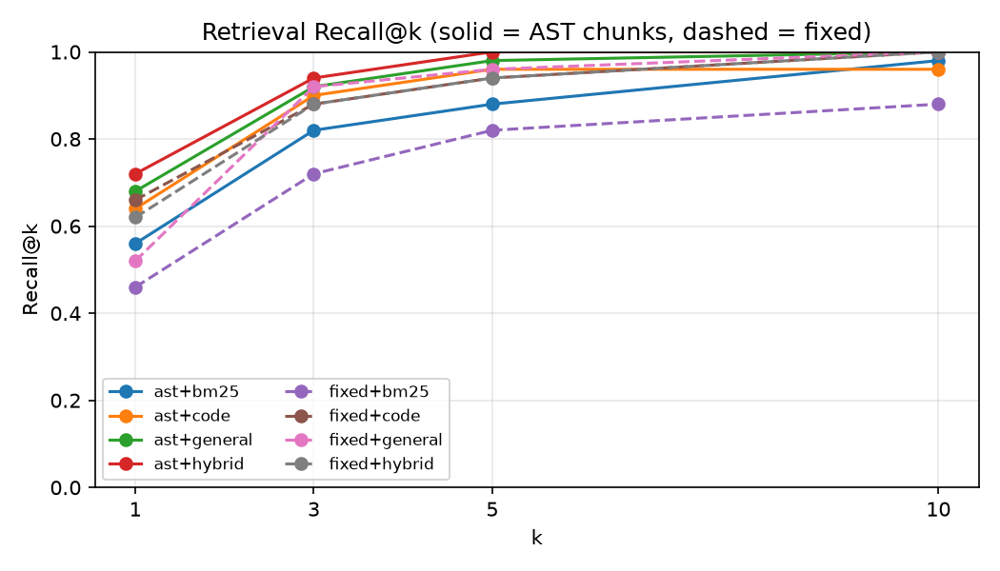

# Codebase QA - Evaluation Report

Repositories (pinned):

- **flask** - https://github.com/pallets/flask @ `3.0.3` (c12a5d874c)
- **requests** - https://github.com/psf/requests @ `v2.32.3` (0e322af877)
- **starlette** - https://github.com/encode/starlette @ `0.38.2` (5ed55c4411)

## 1. Retrieval: chunking x embedding model

50 questions, top-10 retrieved chunks per question. Hit rule: same file and overlap >= 50% of the smaller span.

| config | Recall@1 | Recall@3 | Recall@5 | Recall@10 | MRR@10 | File acc@1 |
|---|---|---|---|---|---|---|
| `ast+hybrid` | 72% | 94% | 100% | 100% | 0.834 | 86% |
| `ast+general` | 68% | 92% | 98% | 100% | 0.810 | 90% |
| `ast+code` | 64% | 90% | 96% | 96% | 0.772 | 84% |
| `fixed+general` | 52% | 92% | 96% | 100% | 0.715 | 84% |
| `fixed+code` | 66% | 88% | 94% | 100% | 0.787 | 84% |
| `fixed+hybrid` | 62% | 88% | 94% | 100% | 0.757 | 84% |
| `ast+bm25` | 56% | 82% | 88% | 98% | 0.697 | 78% |
| `fixed+bm25` | 46% | 72% | 82% | 88% | 0.606 | 74% |

### AST (function/class) chunking vs fixed-size chunking

| retriever | AST R@5 | Fixed R@5 | delta | MRR AST / Fixed |
|---|---|---|---|---|
| bm25 | 88% | 82% | +6 pts | 0.697 / 0.606 |
| code | 96% | 94% | +2 pts | 0.772 / 0.787 |
| general | 98% | 96% | +2 pts | 0.810 / 0.715 |
| hybrid | 100% | 94% | +6 pts | 0.834 / 0.757 |

### Code-specific vs general embedding model

code = `jinaai/jina-embeddings-v2-base-code`, general = `BAAI/bge-base-en-v1.5`

| chunker | code R@5 | general R@5 | delta | MRR code / general |
|---|---|---|---|---|
| ast | 96% | 98% | -2 pts | 0.772 / 0.810 |
| fixed | 94% | 96% | -2 pts | 0.787 / 0.715 |

### Recall@5 per repository

| config | flask | requests | starlette |
|---|---|---|---|
| `ast+code` | 94% | 100% | 94% |
| `ast+general` | 94% | 100% | 100% |
| `ast+bm25` | 94% | 88% | 81% |
| `ast+hybrid` | 100% | 100% | 100% |
| `fixed+code` | 88% | 94% | 100% |
| `fixed+general` | 100% | 94% | 94% |
| `fixed+bm25` | 76% | 88% | 81% |
| `fixed+hybrid` | 100% | 94% | 88% |

### Index statistics

| chunker | repo | files | chunks | avg lines | max lines |
|---|---|---|---|---|---|
| ast | requests | 19 | 275 | 19.7 | 122 |
| ast | flask | 24 | 359 | 24.0 | 141 |
| ast | starlette | 35 | 430 | 15.0 | 93 |
| fixed | requests | 19 | 196 | 38.5 | 40 |
| fixed | flask | 24 | 304 | 38.9 | 40 |
| fixed | starlette | 35 | 237 | 37.8 | 40 |

## Charts

